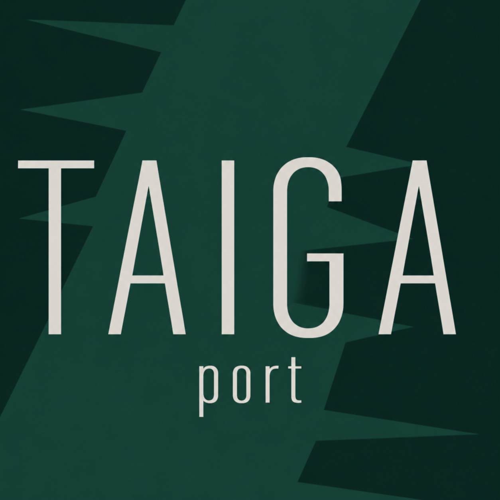

# TAIGA：匠魂合金附加，Forge / 匠魂 3 非官方移植



原版 [Tinkers Alloying Addon](https://somegit.dev/TAIGA/TAIGA) 采用 GPLv3，允许修改、移植和再分发。此移植继续使用 GPL-3.0-only，保留原作者声明；分发二进制时须同时提供对应源码。详见 [LICENSE](LICENSE) 和 [NOTICE.md](NOTICE.md)。这是独立的非官方移植。

Public source: [lingmu0/taiga-tconstruct3-port](https://github.com/lingmu0/taiga-tconstruct3-port). See [releases](https://github.com/lingmu0/taiga-tconstruct3-port/releases) for matching Forge jars, GPL corresponding source and the numeric configuration template.

[CurseForge 项目](https://www.curseforge.com/minecraft/mc-mods/taiga-tconstruct3-port)（项目 ID：1744942）：2026-10-15 已提交三个版本的 Beta 文件，设置为审核通过后自动发布，并开启评论和第三方分发。审核状态以 CurseForge 页面为准。

## 安装

需要 Java 17。客户端和服务端均安装对应 Minecraft 版本的 TAIGA、Tinkers' Construct 和 Mantle。

| Minecraft | Forge 编译验证基准 | Tinkers' Construct 最低版本 | Mantle 最低版本 |
|---|---|---|---|
| 1.18.2 | 40.1.92 | 3.6.4.113 | 1.9.42 |
| 1.19.2 | 43.3.0 | 3.8.2.37 | 1.10.35 |
| 1.20.1 | 47.1.3 | 3.9.2.37 | 1.11.43 |

`2.0.0-port.2` 降低了前置最低版本，并使用表中的较低 Forge 版本重新构建。TAIGA 的 Forge 装载范围保持为对应大版本起（40／43／47），没有添加新的补丁版本限制；匠魂和 Mantle 自身的依赖检查仍然生效。匠魂 1.18.2 的上述版本要求 Forge 40.1.88 起，1.19.2 要求 43.3.0 起。

匠魂允许范围分别为 `[3.6.4.113,3.8)`、`[3.8.2.37,3.9)`、`[3.9.2.37,3.13)`。更早版本存在特性钩子接口差异，因此没有直接放开到所有匠魂 3 版本。各版本构建依赖与装载要求统一保存在 `config/compatibility.json`，重新生成资源时会保留这些要求。

使用版本为 `2.0.0-port.5` 的对应 `.jar`，替换旧版 TAIGA。模组 ID 保留为 `taiga`，同一实例只安装一份 TAIGA。依赖不打包进 TAIGA，须单独安装。[匠魂下载页](https://www.curseforge.com/minecraft/mc-mods/tinkers-construct)、[Mantle 下载页](https://www.curseforge.com/minecraft/mc-mods/mantle)。

`port.3` 沿用 `port.2` 的较低依赖要求。修复流体本身的中英文名称，以及自定义挖掘等级缺少翻译导致的宝典文字换行、重叠；等级在宝典中显示为简短的“5级／6级／7级”。重做下界岩、安山岩、花岗岩、闪长岩和石头底纹矿石，增加深层振金、深层双锂矿石，并恢复零素替换基岩。

`port.4` 为全部 30 种现有匠魂材料增加盔甲设计，提供 18 个盔甲专用词条。1.19.2／1.20.1 使用原生盔甲板与锁甲，可混搭；1.18.2 提供 30 套固定材质的可强化、可修复盔甲，以兼容其原有盔甲接口。维持表中的最低依赖要求。完整数值、制作方式及词条规则见 [ARMOR.md](ARMOR.md)。本次还修正了最低匠魂版本所需的材料调色板数组格式与 1.19.2 的 `supportedStats` 字段。

`port.5` 提供覆盖全部词条的 126 项运行时数值配置，文件为 `taiga-traits.toml`。无需重新编译即可修改伤害、概率、时间、冷却、耐久、槽位和叠加上限。配置按世界保存，在玩家连接时同步；已有背包及穿戴装备自动重算配置影响的属性。使用方式与旧配置迁移见 [CONFIGURATION.md](CONFIGURATION.md)。

## 移植内容

- 39 种流体及流体桶，37 种实体材料的锭、粒、粉和储存块；1.19.2／1.20.1 共 208 个物品，1.18.2 加入 120 件兼容盔甲后共 328 个物品。
- 30 种匠魂工具材料，支持工具头、手柄、绑定、弓臂及握把；原版基础材料数值与部件特性对应保存在 `config/materials.json`。
- 30 种盔甲材料的耐久、防御、韧性、击退抗性，以及独立的板材／锁甲词条配置；盔甲配置在 `config/armor_materials.json`。
- 28 条原版合金路线、熔炼、矿物熔炼、浇铸、砂模、材料修复及燃料配方；统一采用匠魂 3 的 90 mB/锭。
- 37 个材料特性实现及中英文说明。永久成长、击杀回报、满蓄力命中、采掘连锁、掉落处理等使用对应版本的匠魂接口。
- 17 种矿石方块（含 2 种深板岩变体）；13 组矿脉配置与陨石、末地乌鲁矿床。原版纹理随 GPL 许可保留。
- 保留 5／6／7 级挖掘进阶，注册 Forge 有序工具等级，支持其他使用 Forge 工具等级的工具。

## 为匠魂 3 调整的机制

完整特性说明见 [TRAITS.md](TRAITS.md)。噬魂默认每级最多增加 20 伤害；复苏改为击杀治疗与耐久修复；传送改为潜行右键、安全落点、耐久消耗和冷却。近战命中特效要求满蓄力，附加攻击不会重复触发。

原版阿迪特输入改为匠魂 3 的 Hepatizon（黑色金属）。普罗米修姆矿石使用下界合金挖掘等级，可用原版下界合金工具开始，之后制作普罗米修姆工具进入 5 级，再经核素进入 6 级、太阳金属进入 7 级。普通钴工具仍需提升其挖掘等级。

熔炼温度调整到现代匠魂燃料范围。原版熔融岩浆、双锂、硝金燃料路线保留；岩浆块先用 1000°C 熔炼，即可获得后续高温燃料。流体有发光和灼烧效果。

旧版弓的拉弓、射程数据转换为匠魂 3 弓臂属性；旧版独立的弓附加伤害字段不直接搬入新部件格式。旧版额外部件耐久值由匠魂 3 的绑定机制代替。盔甲属性和专用词条为本移植新增设计，工具与盔甲的词条分别配置。

世界生成按现代高度重写：零素在主世界 Y=-64 至 -60 的基岩层替换基岩；振金和双锂根据石头／深板岩宿主生成对应矿石。生成调整只作用于新生成区块，不回填旧区块。陨石和末地矿床限制在单个区块内。陨石岩采掘掉落对应圆石，精准采集保留原块，圆石可烧回原块。未移植旧版强制挖空末地岛屿及额外生成原版铁矿的选项。材料与特性说明通过匠魂现有的材料和工具提示提供；原版匠魂 2 专用书页界面未保留。

## 配置与资源

`config/taiga-common.toml` 在启动后生成，包含特殊矿床开关。词条数值放在世界目录的 `serverconfig/taiga-traits.toml`，可把 [默认模板](config/taiga-traits.toml) 复制到实例的 `defaultconfigs/`，作为新世界默认配置。修改后重启世界／服务器，使所有客户端重新同步。

1.19.2 与 1.20.1 使用 Forge biome modifier 与世界生成 JSON，可通过数据包覆盖。1.18.2 使用其 `BiomeLoadingEvent` 注入；其默认矿脉参数来源于本项目的 `config/worldgen.json`，更改该表后重新生成资源与 Java 适配代码并构建。

匠魂材料、特性绑定和配方均为数据包资源，可按整合包需要调整。各版本资源单独生成，避免 1.18.2 与后续匠魂 JSON 字段格式混用。

8 种矿物采用透明矿粒与现代原版岩石底纹组成的方块模型，包含 10 个矿石外观。底纹引用 `minecraft:block/...`，会随资源包变化；不在本项目中复制或分发 Minecraft 原版纹理。素材原稿、内置图像工具提示词与生成尺寸见 [art/README.md](art/README.md)。

## 从对应源码构建

源码包包含 Gradle wrapper、Java 源码、资源、生成器和许可，不依赖当前工作区的其他项目。

```powershell
python tools/bootstrap.py
python tools/generate_platform.py
python tools/generate_resources.py
foreach ($mcVersion in @('1.18.2','1.19.2','1.20.1')) {
    Push-Location ('forge-' + $mcVersion)
    .\gradlew.bat build --console=plain
    Pop-Location
    if ($LASTEXITCODE -ne 0) { throw ('Build failed: ' + $mcVersion) }
}
python tools/verify_resources.py
```

`bootstrap.py` 下载并校验记录的上游 Maven 依赖到本地 `.deps/maven/`，供 Gradle 使用。`dependencies.lock.json` 记录下载文件的 SHA-256。`import_upstream.py` 仅用于最初从原作者仓库导入数据与纹理，日常构建不需要执行。

当前 `port.5` 使用表中的较低依赖组合执行三个版本的 Java 编译、Forge 混淆打包、资源引用和数据结构检查、进阶可达性检查及成品资源一致性检查。盔甲检查包含 30 种材料数据与词条、原生部件配方入口、1.18.2 合成／修复和标签继承，以及对 port.3 工具属性的回归对比。纯 Java 数值测试覆盖 5259 个伤害类型、生命阈值、混搭、上限和自定义配置场景；检查非法修改的原子拒绝和默认值恢复，不加载游戏。额外检查 126 项配置与实际逻辑的完整对应、TOML 模板和翻译。

保留流体／等级翻译、深层矿石、零素生成和原有配方检查。最低匠魂版本中的外部模型、铸模标签及调色板格式也参与校验。1.20.1 客户端已启动并完成资源加载，游戏画面、盔甲穿戴、战斗交互、宝典页面、世界生成和联机行为仍待实测；1.18.2／1.19.2 尚未进行游戏内验证。
